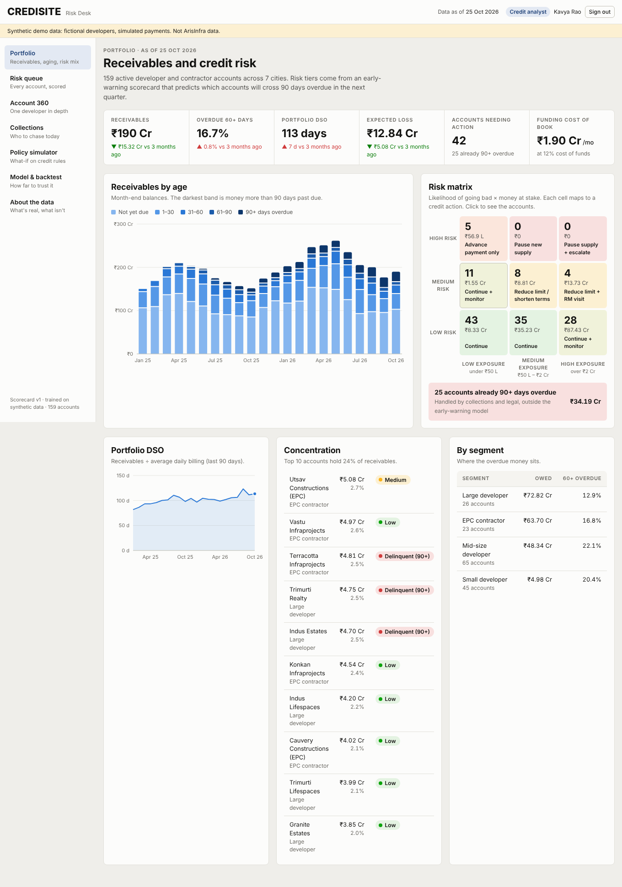
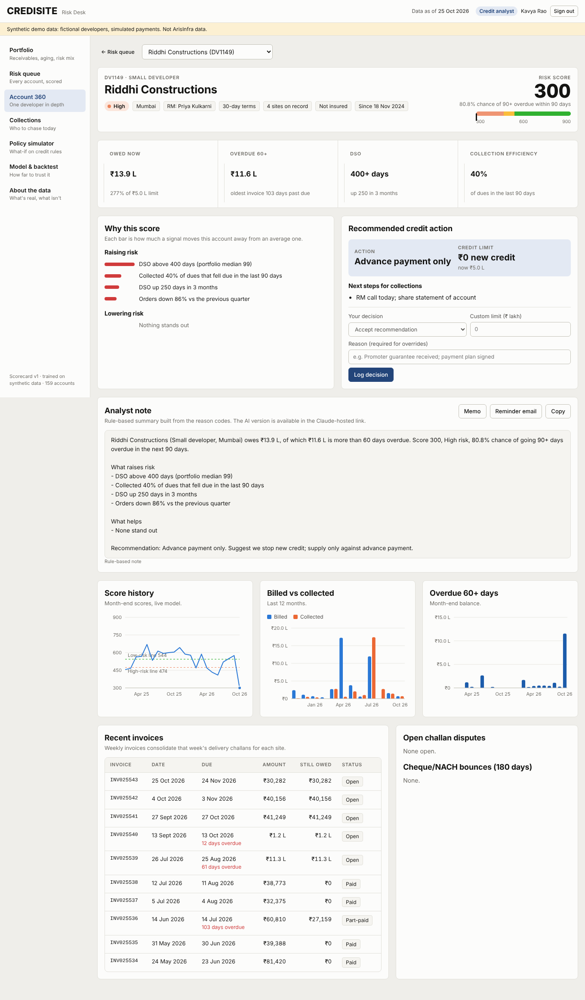

# CrediSite: early-warning credit risk for construction materials

**Know which builder will stop paying before the aging report does.**

A product prototype for a B2B construction-materials platform that sells cement, steel, RMC and aggregates to developers on credit. It scores every account monthly, explains why, maps each account to a credit action and limit, ranks collections, and lets leadership price a credit policy before changing it.

> **All data is synthetic.** The developers are fictional and nothing here is ArisInfra or customer data. The generator is in this repo so every number can be reproduced.

| | |
|---|---|
| **Live demo** | https://ansharora-vlsi.github.io/credisite/ (GitHub Pages, after you enable it) |
| **Demo logins** (password `demo1234`) | `analyst@credisite.demo` (everything, can log decisions) · `rm.priya@credisite.demo` (own accounts only) · `cfo@credisite.demo` (portfolio, simulator, model) |
| **PRD** | [PRD.md](PRD.md) |



## Results (out-of-time backtest)

Trained on Jan–Dec 2025 month-end snapshots, tested on Jan–Jun 2026, which the model never saw.

| | Aging report rule (dues 60+ days late) | CrediSite scorecard (Medium + High tiers) |
|---|---|---|
| Alerts per month | 83 | **51** |
| Bad accounts caught (recall) | 87% | **96%** |
| Alerts that were right (precision) | 9.2% | **16.7%** |

- AUC **0.86**, within about 1.5 points of a black-box gradient-boosting model, while keeping exact reason codes.
- All **18 of 18** accounts that went bad in the test period were flagged High beforehand, a **median 45 days** before crossing 90 days overdue.
- The policy simulator surfaced the break-even rule: holding back credit only pays when **PD × loss-given-default exceeds gross margin** (about 18% PD at 9% margin and 50% LGD).

## What's in the dashboard

| View | For | What it shows |
|---|---|---|
| Portfolio | CFO, credit head | Receivables by age, DSO trend, risk matrix (likelihood × exposure → action), concentration |
| Risk queue | Credit analyst, RM | Every account worst-first with tier, PD, action and top reason; AI "ask the portfolio" filter |
| Account 360 | Analyst, RM | Score and reasons, recommended action and limit, decision log with override reasons, AI credit memo and reminder email, invoices, disputes, bounces |
| Collections | Collections team | Who to call today, ranked by overdue × risk, with a next step each |
| Policy simulator | CFO | Cutoffs, payment-delay shock, LGD and margin → sales held back, loss avoided, DSO and funding cost |
| Model & backtest | Everyone | Comparison with today's rules, weights, calibration, known limits |



## How it works

```
generate_data.py   160 developers, 2 years, weekly: sites → challans → invoices → payments
                   (stage-driven material mix, monsoon dip, late-paying norms by segment,
                    stress events that recover / default / hit suddenly, disputes, bounces,
                    credit holds, EPC lump payments)
       │
features.py        month-end snapshots using only data available on that date
                   + forward label: crosses 90+ days overdue within the next 90 days
       │
model.py           logistic scorecard with sign constraints, out-of-time backtest,
                   baselines (aging rule, limit breach), gradient-boosting benchmark,
                   calibration, warning lead time
       │
pipeline.py        live scoring → tiers → risk matrix action → recommended limit
                   → collections priority → web/data.json
       │
build_web.py       single-file dashboard: dist/credisite.html and docs/index.html
```

**Simulated data:** 160 accounts · ~650 sites · ~224,000 truck challans · ~27,000 invoices · ~29,000 receipts · ~3,900 challan disputes · ~270 cheque bounces. Annual billing is about ₹700–800 Cr with ₹150–260 Cr receivables, roughly the scale of a listed player in this space.

**Design choices worth defending:**
- **Logistic scorecard over a black box.** A credit team has to explain a limit cut to Sales and sometimes to the customer. Each reason code is that signal's exact contribution.
- **Sign constraints.** If a weight flips against credit logic (usually collinearity), the feature is dropped. A reason code that says "more overdue lowers your risk" would end trust in the tool.
- **No relationship-age feature.** Most synthetic accounts start on the same date, so it would only track the calendar and leak time into the model.
- **Already-delinquent accounts are excluded from early warning.** They are a collections problem, not a prediction problem.
- **Honest calibration.** The top PD band over-predicts (59% predicted vs 30% observed). That's fine for ranking, not for provisioning; the model card says so.

## Run it

```bash
pip install -r requirements.txt
python -m src.pipeline      # generate data, build features, backtest, score  (~25 s)
python -m src.build_web     # bundle the dashboard
open docs/index.html        # or any static server
```

Optional browser test (every role and view, light and dark, phone and desktop):

```bash
python -m playwright install chromium
python tests/test_dashboard.py
```

**Publish on GitHub Pages:** push the repo, then *Settings → Pages → Deploy from branch → main / docs*.

The AI analyst (credit memos, reminder emails, plain-English queries) runs when the page is opened through its Claude-hosted link. On GitHub Pages it falls back to rule-based notes built from the same reason codes.

## Project layout

```
src/            config, generator, features, model, pipeline, web bundler
web/app.html    dashboard source (vanilla JS, SVG charts, no build tools)
docs/           GitHub Pages build
data/           generated tables (challans.csv is regenerated, not committed)
tests/          headless-browser smoke test
PRD.md          product requirements
```

## Limits

Synthetic data proves the method, not the numbers. On real data the features carry over, but weights, tiers and cutoffs must be refit and re-tested, ideally after an 8-week shadow run (see [PRD.md](PRD.md) §7). Payment data can't see project approvals or promoter news, which is where sudden failures come from.
